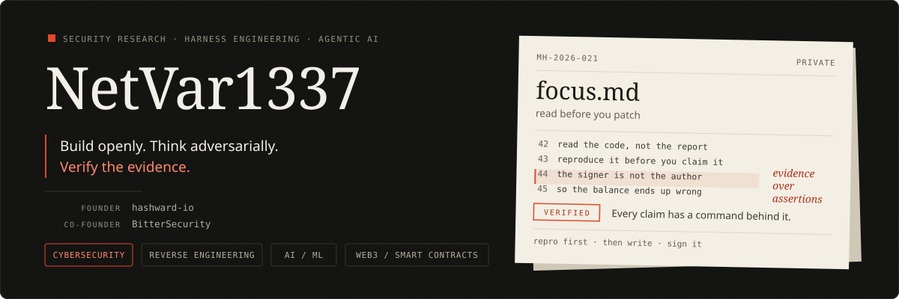
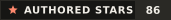
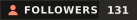
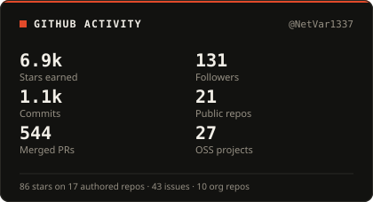
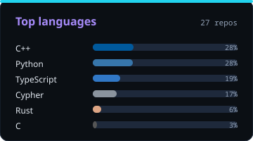

  

**Security Researcher · Harness Engineer · Agentic AI**

I build the harnesses that let autonomous agents do real security work — tools, sandboxes, debugger
bindings and verification loops. Founder of [hashward](https://hashward.io/), co-founder of
[BitterSecurity](https://bittersecurity.com/), based in Norway.

## Selected Projects

| Project | Stack | Description |
| :--- | :--- | :--- |
| [**omniwire**](https://github.com/NetVar1337/omniwire) | `TypeScript · MCP` | Infrastructure for AI agent swarms — 88 MCP tools, A2A, mesh VPN, CDP browser, 2FA. |
| [**Kevlar**](https://github.com/NetVar1337/Kevlar) | `C++ · Kernel` | Unified Windows kernel-driver emulation and analysis harness. |
| [**EchoDebug**](https://github.com/NetVar1337/EchoDebug) | `Tauri · React · MCP` | Windows reverse-engineering workbench with a WebSocket relay and MCP server. |
| [**claude-for-firefox**](https://github.com/NetVar1337/claude-for-firefox) | `WebExtensions · JS` | Community Firefox browser extension for Claude with sidebar chat and automation. |
| [**mcp-ctl**](https://github.com/NetVar1337/mcp-ctl) | `Zig · Python` | Zero-intervention MCP lifecycle manager for AI CLIs. |

## Open Source & Upstream Work

| Project | Stars | My work |
| :--- | :---: | :--- |
| [**Decepticon**](https://github.com/BitterSecurity/Decepticon) |  | Autonomous red-team agent. **Core contributor — #2 all-time, 400+ commits.** |
| [**x64dbg**](https://github.com/x64dbg/x64dbg/pull/4003) |  | Merged: macOS cross-build in CI. |
| [**oh-my-pi**](https://github.com/can1357/oh-my-pi/pulls?q=is%3Apr+author%3ANetVar1337+is%3Amerged) |  | 4 merged PRs: MCP stdio handling, provider retries, Win32 terminal fix. |
| [**Serena**](https://github.com/oraios/serena/pull/1173) |  | Merged: rust-analyzer detection from `PATH`. |
| [**claude-code-action**](https://github.com/anthropics/claude-code-action/pull/1055) |  | Merged: fix for `claude_args` shell-comment parsing. |

## Stack

  
  
  
  
  
  
  
   
  
  
  
  
  

  
  

[**X**](https://x.com/NetVar1337) &nbsp;·&nbsp; [**hashward.io**](https://hashward.io/) &nbsp;·&nbsp; [**bittersecurity.com**](https://bittersecurity.com/) &nbsp;·&nbsp; [**decepticon.red**](https://decepticon.red/) &nbsp;·&nbsp; [**TryHackMe**](https://tryhackme.com/p/NetVar)

