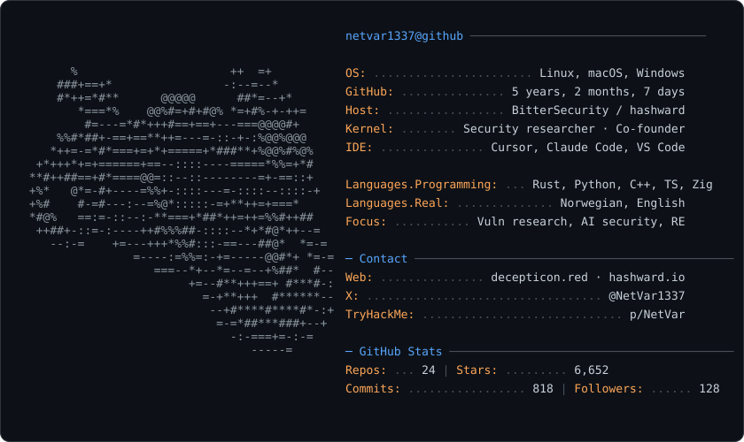
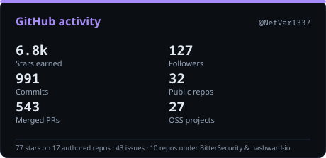
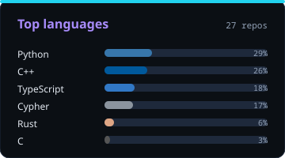

<picture>
  <source media="(prefers-color-scheme: light)" srcset="./assets/banner.svg" />
  <source media="(prefers-color-scheme: dark)" srcset="./assets/dark_mode.svg" />
  
</picture>

 

**Security Researcher · Harness Engineer · Agentic AI · Norway**

[**Decepticon ↗**](https://decepticon.red/) &nbsp;·&nbsp; [**hashward ↗**](https://hashward.io/) &nbsp;·&nbsp; [**BitterSecurity ↗**](https://bittersecurity.com/) &nbsp;·&nbsp; [**X ↗**](https://x.com/NetVar1337) &nbsp;·&nbsp; [**TryHackMe ↗**](https://tryhackme.com/p/NetVar)

 

**[About](#about)** · **[Now](#now)** · **[Projects](#projects)** · **[Contributions](#contributions)** · **[Toolchain](#toolchain)** · **[Activity](#activity)** · **[Contact](#contact)**

 

## About

I'm **NetVar** — founder of **hashward** and co-founder of **BitterSecurity**. I work where security
research meets agentic AI: I build the harnesses that let autonomous agents do real security work — the
tools, sandboxes, debugger and emulator bindings, and verification loops that turn a model into something
that finds, proves, and explains vulnerabilities on real systems, within an authorized scope.

- **Security research** — Windows kernel-driver emulation, Linux kernel patches, PCIe/NVMe HDL, and IDA / Ghidra / x64dbg tooling.
- **Harness engineering** — MCP servers, agent infrastructure, and reverse-engineering workbenches designed to be driven by agents as well as people.
- **#2 all-time contributor to [Decepticon](https://github.com/BitterSecurity/Decepticon)** — an autonomous red-team agent with 6.6k★, where I've landed 400+ commits.
- **26 merged PRs to other people's projects**, including [Anthropic's claude-code-action](https://github.com/anthropics/claude-code-action/pull/1055), [x64dbg](https://github.com/x64dbg/x64dbg/pull/4003), [Serena](https://github.com/oraios/serena/pull/1173), and 8 feature PRs to the [Recurse](https://github.com/Recurse-Labs/recurse) RE IDE.
- **Open to security research, vulnerability research, and AI security roles** — reach me on [X](https://x.com/NetVar1337) or via [hashward.io](https://hashward.io/).

## Currently

- Building **[Decepticon](https://decepticon.red/)** and **[hashward](https://hashward.io/)** — autonomous offensive-security agents and the RE tooling behind them.
- Building **[EchoDebug](https://github.com/NetVar1337/EchoDebug)** and **[SlopStation](https://github.com/NetVar1337/SlopStation)** — reverse-engineering workbenches with built-in MCP control for agents.
- Maintaining **[KEVLAR](https://github.com/NetVar1337/Kevlar)**, **[omniwire](https://github.com/NetVar1337/omniwire)** and **[mcp-ctl](https://github.com/NetVar1337/mcp-ctl)** — kernel-driver emulation and agent infrastructure.
- Landing upstream PRs ([Recurse](https://github.com/Recurse-Labs/recurse), [PCILeechGen](https://github.com/sercanarga/PCILeechGen), [x64dbg](https://github.com/x64dbg/x64dbg), [oh-my-pi](https://github.com/can1357/oh-my-pi), …) and publishing audit playbooks via **[audit-findings-skills](https://github.com/NetVar1337/audit-findings-skills)**.

---

## Featured projects

### Autonomous security agents

| Project | Stars | What it is |
| :--- | ---: | :--- |
| [**Decepticon**](https://github.com/BitterSecurity/Decepticon) |  | Autonomous hacking agent for authorized red-team operations. **Core contributor (#2, 400+ commits).** |
| [**Vigilo**](https://github.com/BitterSecurity/Vigilo) |  | AI hacker for Web3 smart contracts — built for bug bounties and audit contests. |
| [**PurpleAILAB**](https://github.com/BitterSecurity/purpleailab.com) |  | Agentic cybersecurity harness, with its site and knowledge vault. |
| [**AutoBot**](https://github.com/BitterSecurity/AutoBot) |  | Autonomous defense agent for the blue team. |
| [**Cybertron**](https://github.com/BitterSecurity/Cybertron) |  | Autonomous security-intelligence agent. |

### Vulnerability research & reverse engineering

| Project | What it is |
| :--- | :--- |
| [**KEVLAR**](https://github.com/NetVar1337/Kevlar) | Windows x64 kernel-driver emulation and behaviour analysis, built on Unicorn + Zydis. |
| [**EchoDebug**](https://github.com/NetVar1337/EchoDebug) | Windows reverse-engineering workbench (Tauri + React) with a WebSocket relay and an MCP server for agent-driven analysis. |
| [**SlopStation**](https://github.com/NetVar1337/SlopStation) | PS4 reverse-engineering workbench: live memory, debugger, scanner, decompiler, x86-64 emulator, Lua and MCP. |
| [**ps4debug-mcp**](https://github.com/NetVar1337/ps4debug-mcp) | MCP server and Python client for ps4debug-NG — agent-driven dynamic analysis on console targets. |
| [**AiDA**](https://github.com/NetVar1337/AiDA-Fork) | Native C++ AI-assistant plugin for IDA Pro 9.x. |
| [**audit-findings-skills**](https://github.com/NetVar1337/audit-findings-skills) | 23,625 smart-contract audit findings distilled into reusable review playbooks. |
| [**linux-rk3576-rocket**](https://github.com/NetVar1337/linux-rk3576-rocket) | RFC patch series adding RK3576 support to the mainline Linux Rocket NPU driver. |

### Agent harnesses & infrastructure

| Project | Stars | What it is |
| :--- | ---: | :--- |
| [**claude-for-firefox**](https://github.com/NetVar1337/claude-for-firefox) |  | Community Firefox extension: Claude in the sidebar, with chat and browser automation. |
| [**omniwire**](https://github.com/NetVar1337/omniwire) |  | Infrastructure for AI agent swarms — 88 MCP tools, A2A, mesh VPN, CDP browser. |
| [**mcp-ctl**](https://github.com/NetVar1337/mcp-ctl) |  | Zero-intervention MCP lifecycle manager for every AI CLI, written in Zig. |

---

## Open-source contributions

Merged upstream work — [all merged PRs ↗](https://github.com/pulls?q=is%3Apr+author%3ANetVar1337+is%3Amerged+-user%3ANetVar1337)

| Project | Merged PRs | Highlights |
| :--- | :---: | :--- |
| [**Recurse-Labs/recurse**](https://github.com/Recurse-Labs/recurse/pulls?q=is%3Apr+author%3ANetVar1337+is%3Amerged) | 8 | Decompiler, symbolic execution, MCP server and Python bindings; VTIL-inspired de-virtualization IL; multi-provider AI auth; signed auto-update |
| [**sercanarga/PCILeechGen**](https://github.com/sercanarga/PCILeechGen/pulls?q=is%3Apr+author%3ANetVar1337+is%3Amerged) | 9 | NVMe admin/IO queue emulation in HDL, PRP2 page-crossing, offline mmiotrace import, VFIO diagnostics tests |
| [**can1357/oh-my-pi**](https://github.com/can1357/oh-my-pi/pulls?q=is%3Apr+author%3ANetVar1337+is%3Amerged) | 4 | MCP stdio broken-pipe handling, Ollama 5xx retries and history sanitising, Win32 terminal escape-sequence relay fix |
| [**anthropics/claude-code-action**](https://github.com/anthropics/claude-code-action/pull/1055) | 1 | Fix `claude_args` parsing of shell comment lines |
| [**x64dbg/x64dbg**](https://github.com/x64dbg/x64dbg/pull/4003) | 1 | macOS cross-build in CI |
| [**oraios/serena**](https://github.com/oraios/serena/pull/1173) | 1 | Detect rust-analyzer from `PATH` without rustup |
| [**sinnafuls/enma-lsp**](https://github.com/sinnafuls/enma-lsp/pull/1) | 1 | LSP feature-set expansion |

### Recently shipped

Latest merged pull requests outside my own repos — refreshed daily by GitHub Actions.

<!-- shipped:start -->
- **[Pharaoh2k/ps4debug-NG#3](https://github.com/Pharaoh2k/ps4debug-NG/pull/3)** — PROTOCOL.md: fix reg64 size, fw encoding, fpu size · 2026-11-12
- **[can1357/oh-my-pi#18465](https://github.com/can1357/oh-my-pi/pull/18465)** — fix(tui): hold a relayed win32 OSC/DCS/APC string until its terminator · 2026-11-08
- **[Recurse-Labs/recurse#7](https://github.com/Recurse-Labs/recurse/pull/7)** — feat: in-app auto-update, quick-install scripts, and signed release pipeline · 2026-10-29
- **[x64dbg/x64dbg#4003](https://github.com/x64dbg/x64dbg/pull/4003)** — cross: build on macOS in CI · 2026-10-28
- **[BitterSecurity/Decepticon#1112](https://github.com/BitterSecurity/Decepticon/pull/1112)** — test: measure core/SDK coverage and add core-SDK re-export contract test · 2026-10-26
- **[BitterSecurity/docs#3](https://github.com/BitterSecurity/docs/pull/3)** — ci: local docs checks (mintlify validate + broken-links + EN/KO parity), optional Actions workflow · 2026-10-26
<!-- shipped:end -->

<strong>Detection research — anti-cheat & account abuse</strong>

 

| Project | What it is |
| :--- | :--- |
| [**account-security**](https://github.com/NetVar1337/account-security) | Account takeover, credential stuffing, session and inventory abuse detection for game platforms — graph-based analysis. |
| [**cheat-intel**](https://github.com/NetVar1337/cheat-intel) | Cheat-community intelligence: monitoring methodology, trend reporting, and the intel → detection feedback loop. |
| [**apex-anticheat-lab**](https://github.com/NetVar1337/apex-anticheat-lab) | FPS anti-cheat lab — runnable synthetic fixtures, cohort-aware baselines, explainable scores. |

These are independent research projects, not evidence of production deployment or employment with a
game studio or anti-cheat vendor. The lab uses **synthetic data**, and its YARA sketches are **not
operational detection rules**.

<strong>Hardware & embedded</strong>

 

[**flipctld**](https://github.com/NetVar1337/flipctld) — menu-UI core for Flipper One (JSON manifests, D-pad navigation, ANSI + framebuffer)
 [**flipper-profile**](https://github.com/NetVar1337/flipper-profile) — btrfs + overlayfs snapshot profiles for Flipper One
 [**PCILeechGen contributions**](https://github.com/sercanarga/PCILeechGen/pulls?q=is%3Apr+author%3ANetVar1337+is%3Amerged) — PCIe / NVMe device emulation in HDL

---

## Toolchain

  
   
  

<table>
<tr>
<td width="50%" valign="top">

**Reverse engineering**

IDA Pro 9.x + IDAPython · Ghidra · x64dbg · radare2 · Unicorn · Zydis · Capstone · YARA · LIEF

**Offensive security**

Autonomous red-team agents · fuzzing · kernel-driver analysis · smart-contract auditing

</td>
<td width="50%" valign="top">

**Agent harnesses**

Harness & tool design · MCP (Model Context Protocol) · A2A · agent swarms · Playwright / CDP · Claude Code · Codex CLI

**Low-level & hardware**

Linux kernel · eBPF · PCIe / NVMe HDL · Flipper One · RP2350 · embedded firmware · USB protocol work

</td>
</tr>
</table>

---

## How I work

| **01 / Scope** | **02 / Evidence** | **03 / Disclosure** |
| :--- | :--- | :--- |
| Test only within an explicitly authorized scope, starting from the threat model. | Every finding ships with a reproducible proof and its limitations stated. | Report responsibly, and turn the lesson into tooling others can inspect. |

---

## Activity

  
  

---

## Get in touch

Open to **security research, vulnerability research, and AI security roles**.

| Channel | Link |
| :--- | :--- |
| X / Twitter | [**@NetVar1337 ↗**](https://x.com/NetVar1337) — fastest way to reach me |
| Company | [**hashward.io ↗**](https://hashward.io/) |
| Product | [**decepticon.red ↗**](https://decepticon.red/) |
| CTF profile | [**TryHackMe ↗**](https://tryhackme.com/p/NetVar) |
| Support the work | [**Sponsor on GitHub ↗**](https://github.com/sponsors/NetVar1337) |

Build openly. Think adversarially. Verify the evidence.

