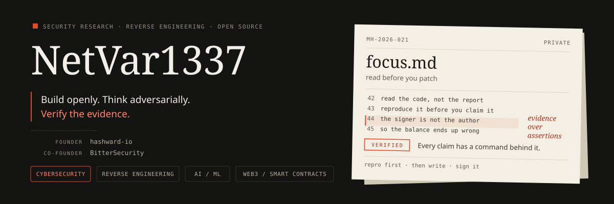

 

**Norwegian builder · Open-source enthusiast · Security researcher**

[**hashward ↗**](https://hashward.io/) &nbsp; / &nbsp; [**BitterSecurity ↗**](https://bittersecurity.com/) &nbsp; / &nbsp; [**Decepticon ↗**](https://decepticon.red/)

[GitHub](https://github.com/NetVar1337) &nbsp; · &nbsp; [X](https://x.com/NetVar1337) &nbsp; · &nbsp; [TryHackMe](https://tryhackme.com/p/NetVar)

 

## 👋 Behind the handle

I'm **NetVar** — founder of **hashward** and co-founder of **BitterSecurity**. I'm interested in how systems work, how they fail, and how to make them harder to abuse.

My interests connect **ethical hacking**, **reverse engineering**, **AI/ML**, and **smart contract security**. Open source is where I share the work and learn from others.

> Clear assumptions. Reproducible experiments. Conclusions that stay within the evidence.

 

## 🛠️ Building & contributing

<table>
<tr>
<td width="33%" valign="top">

### ◈ hashward
**Founder**

Building in the open.

[Website ↗](https://hashward.io/) 
[Organization ↗](https://github.com/hashward-io)

</td>
<td width="33%" valign="top">

### ⬡ BitterSecurity
**Co-founder**

Part of my security work.

[Website ↗](https://bittersecurity.com/) 
[Organization ↗](https://github.com/BitterSecurity)

</td>
<td width="33%" valign="top">

### ⌁ Decepticon
**Contributor**

An agent for authorized red-team work.

[Website ↗](https://decepticon.red/) 
[Repository ↗](https://github.com/BitterSecurity/Decepticon)

</td>
</tr>
</table>

 

## 🧭 What I explore

| | Focus | Questions that interest me |
| :---: | :--- | :--- |
| 🛡️ | **Security & ethical hacking** | Where are the attack paths, and how can authorized testing improve defenses? |
| 🔬 | **Reverse engineering** | What does the software actually do beyond the source code? |
| 🧠 | **AI / ML** | Where can models help security research and tooling? |
| 🔗 | **Smart contracts & Web3** | Which trust assumptions break, and what happens when they do? |
| 🌱 | **Open source** | How can shared, inspectable work help others build and learn? |

 

## 🔎 Research workbench

Independent explorations of **game integrity**, **detection engineering**, and **account abuse**.

### 🎯 [apex-anticheat-lab ↗](https://github.com/NetVar1337/apex-anticheat-lab)
Synthetic detection fixtures, cohort-aware baselines, and explainable scores.

**Worth inspecting:** an investigation where a high-skill human outranks a recoil script on the composite score — a reminder that a score is not a verdict.

---

### 📡 [cheat-intel ↗](https://github.com/NetVar1337/cheat-intel)
Evaluating community claims, classifying threats, and making source limitations explicit.

**The focus:** distinguish an interesting claim from evidence that supports a conclusion.

---

### 🕸️ [account-security ↗](https://github.com/NetVar1337/account-security)
Exploring account-takeover and session-abuse signals through graph-based analysis.

**The focus:** relationships and behavior, not just a login rate-limit.

<strong>Research scope & limitations</strong>

These are independent research projects, not evidence of production deployment or employment with a game studio or anti-cheat vendor.

- The anti-cheat lab uses **synthetic data**.
- Its YARA sketches are **not operational detection rules**.
- Decepticon is separate work intended for **authorized red-team use**.

 

## ⚖️ How I approach the work

| **01 / Context** | **02 / Evidence** | **03 / Permission** |
| :--- | :--- | :--- |
| Understand the threat model and what the data can establish. | Explain the detection, expose limitations, and make experiments reproducible. | Test within an explicitly authorized scope and disclose responsibly. |

 

### Let's build something worth inspecting.

Open-source collaboration · Security research · Detection engineering

[**Find me on GitHub ↗**](https://github.com/NetVar1337) &nbsp; · &nbsp; [**Connect on X ↗**](https://x.com/NetVar1337) &nbsp; · &nbsp; [**TryHackMe ↗**](https://tryhackme.com/p/NetVar)

Build openly. Think adversarially. Verify the evidence.

