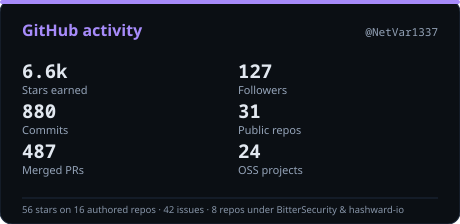
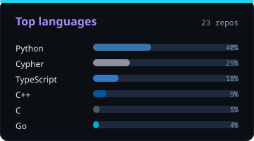

 

 

**Norwegian builder · Security researcher · Reverse engineer · Open-source enthusiast**

[**hashward ↗**](https://hashward.io/) &nbsp;·&nbsp; [**BitterSecurity ↗**](https://bittersecurity.com/) &nbsp;·&nbsp; [**Decepticon ↗**](https://github.com/BitterSecurity/Decepticon)

[GitHub](https://github.com/NetVar1337) &nbsp;·&nbsp; [X](https://x.com/NetVar1337) &nbsp;·&nbsp; [TryHackMe](https://tryhackme.com/p/NetVar)

 

## 👋 Behind the handle

I'm **NetVar** — founder of **hashward** and co-founder of **BitterSecurity**. I work on autonomous
security agents, reverse-engineering tooling, and the infrastructure that lets AI agents operate
reliably on real systems.

My interests connect **ethical hacking**, **reverse engineering**, **AI/ML**, and **smart contract
security**. Open source is where I share the work and learn from others.

> Clear assumptions. Reproducible experiments. Conclusions that stay within the evidence.

---

## 🚀 Featured work

### 🤖 Autonomous security agents — BitterSecurity

| Project | Stars | What it is |
| :--- | ---: | :--- |
| [**Decepticon**](https://github.com/BitterSecurity/Decepticon) | 6.4k | Autonomous hacking agent for authorized red-team operations. The largest public project I contribute to. |
| [**Vigilo**](https://github.com/BitterSecurity/Vigilo) | 70 | AI hacker for Web3 smart contracts — built for bug bounties and audit workflows. |
| [**PurpleAILAB**](https://github.com/BitterSecurity/purpleailab.com) | 7 | Agentic cybersecurity harness with its marketing site and knowledge vault. |
| [**AutoBot**](https://github.com/BitterSecurity/AutoBot) | 1 | Autonomous defense agent for the blue team. |
| [**Cybertron**](https://github.com/BitterSecurity/Cybertron) | 1 | Autonomous security intelligence for humanity. |

### 🧩 Open-source tooling

| Project | Stars | What it is |
| :--- | ---: | :--- |
| [**vibe-island**](https://github.com/NetVar1337/vibe-island) | 70 | Dynamic Island for AI coding tools — Rust + Tauri, macOS / Windows / Linux. |
| [**claude-for-firefox**](https://github.com/NetVar1337/claude-for-firefox) | 19 | Claude for Firefox — a community browser extension with sidebars. |
| [**omniwire**](https://github.com/NetVar1337/omniwire) | 17 | Infrastructure for AI agent swarms — 88 MCP tools, A2A protocol, mesh networking. |
| [**KEVLAR**](https://github.com/NetVar1337/Kevlar-Ultimate) | 6 | Windows x64 kernel-driver emulation and behaviour analysis, powered by Unicorn + Zydis. |
| [**decepticon-ghidra-mcp**](https://github.com/NetVar1337/decepticon-ghidra-mcp) | 5 | Ghidra MCP — P-code, BSim, version tracking, and emulation. |
| [**mcp-ctl**](https://github.com/NetVar1337/mcp-ctl) | 3 | Zero-intervention MCP lifecycle manager for every AI CLI. Written in Zig. |
| [**agent-skill-canon**](https://github.com/NetVar1337/agent-skill-canon) | 2 | 1,200+ executable skill files for coding agents and security harnesses. |
| [**codex-patcher-cc**](https://github.com/NetVar1337/codex-patcher-cc) | 2 | Codex CLI patcher — Rust Mach-O patches, wrapper, and config injection. |

### 🔬 Independent research

| Project | What it is |
| :--- | :--- |
| [**account-security**](https://github.com/NetVar1337/account-security) | Account takeover, credential stuffing, session abuse, and identity fraud for game platforms — graph-based analysis. |
| [**cheat-intel**](https://github.com/NetVar1337/cheat-intel) | Cheat-community intelligence: monitoring methodology, trend reporting, and the intel → detection feedback loop. |
| [**apex-anticheat-lab**](https://github.com/NetVar1337/apex-anticheat-lab) | FPS anti-cheat lab — runnable synthetic fixtures, cohort-aware baselines, explainable scores. |
| [**audit-findings-skills**](https://github.com/NetVar1337/audit-findings-skills) | Audit workflow findings packaged as reusable agent skills. |

### 🔧 Systems, hardware & reverse engineering

[**recurse**](https://github.com/NetVar1337/recurse) — AI-native IDE for reverse engineering
&nbsp;·&nbsp; [**ultrafuzz**](https://github.com/NetVar1337/ultrafuzz) — agentic smart-contract fuzzing
&nbsp;·&nbsp; [**flipperone-mcu-firmware**](https://github.com/NetVar1337/flipperone-mcu-firmware) — Flipper One RP2350 co-processor firmware
&nbsp;·&nbsp; [**linux-rk3576-rocket**](https://github.com/NetVar1337/linux-rk3576-rocket) — RK3576 NPU RFC patch series for mainline
&nbsp;·&nbsp; [**AiDA**](https://github.com/NetVar1337/AiDA-Fork) — native C++ assistant plugin for IDA Pro 9.x

<strong>Research scope &amp; limitations</strong>

These are independent research projects, not evidence of production deployment or employment with a
game studio or anti-cheat vendor.

- The anti-cheat lab uses **synthetic data**.
- Its YARA sketches are **not operational detection rules**.
- Decepticon is separate work intended for **authorized red-team use**.

---

## 🧰 Toolchain

<table>
<tr>
<td width="50%" valign="top">

**Languages**
Python · TypeScript · Rust · C++ · C · Go · Zig · Java · JavaScript · Solidity · Assembly · Bash

**Reverse engineering**
IDA Pro 9.x + IDAPython · Ghidra · radare2 · r2pipe · Unicorn · Zydis · Capstone · YARA · LIEF

</td>
<td width="50%" valign="top">

**AI & agents**
MCP (Model Context Protocol) · agent swarms · A2A · Playwright · Claude Code · Codex CLI · prompt engineering

**Systems**
Linux kernel · eBPF · Tauri 2 · React · Node.js · Docker · GitHub Actions · PostgreSQL · Redis

**Hardware**
Flipper One · RP2350 · embedded firmware · USB protocol work

</td>
</tr>
</table>

---

## 🧭 What I explore

| | Focus | Questions that interest me |
| :---: | :--- | :--- |
| 🛡️ | **Security & ethical hacking** | Where are the attack paths, and how can authorized testing improve defenses? |
| 🔬 | **Reverse engineering** | What does the software actually do beyond the source code? |
| 🧠 | **AI / ML** | Where can models help security research and tooling? |
| 🤖 | **Agent infrastructure** | How do you make autonomous agents reliable, inspectable, and safe to point at real systems? |
| 🔗 | **Smart contracts & Web3** | Which trust assumptions break, and what happens when they do? |
| 🌱 | **Open source** | How can shared, inspectable work help others build and learn? |

---

## ⚖️ How I approach the work

| **01 / Context** | **02 / Evidence** | **03 / Permission** |
| :--- | :--- | :--- |
| Understand the threat model and what the data can establish. | Explain the detection, expose limitations, and make experiments reproducible. | Test within an explicitly authorized scope and disclose responsibly. |

---

## 📊 GitHub activity

## 🐍 Contribution graph

<picture>
  <source media="(prefers-color-scheme: dark)" srcset="https://github.com/NetVar1337/NetVar1337/raw/output/github-contribution-grid-snake-dark.svg" />
  <source media="(prefers-color-scheme: light)" srcset="https://github.com/NetVar1337/NetVar1337/raw/output/github-contribution-grid-snake.svg" />
  
</picture>

---

### Let's build something worth inspecting.

Open-source collaboration · Security research · Detection engineering · Agent infrastructure

[**Find me on GitHub ↗**](https://github.com/NetVar1337) &nbsp;·&nbsp; [**Connect on X ↗**](https://x.com/NetVar1337) &nbsp;·&nbsp; [**TryHackMe ↗**](https://tryhackme.com/p/NetVar)

Build openly. Think adversarially. Verify the evidence.

